<div align="center">

<picture>
  <source media="(prefers-color-scheme: dark)" srcset="assets/banner-dark.svg">
  <source media="(prefers-color-scheme: light)" srcset="assets/banner-light.svg">
  
</picture>

<br/>

[](https://www.amd.com/en/products/processors/consumer/ryzen-ai.html)
[](https://ryzenai.docs.amd.com/en/latest/)
[](#-動作要件)
[](LICENSE)

[English](README.md) · [简体中文](README.zh-CN.md) · **日本語**

**CPU でも GPU でもなく、*AMD Ryzen AI NPU 上でネイティブに動作する*ブラウザベースの Stable Diffusion ストレステストです。<br/>数時間にわたる連続実行で、どれだけ速く、どれだけ安定して動き続けるかがわかります。**

</div>

<!-- スクリーンショット枠：テスト実行中の実際のスクリーンショットを assets/dashboard.png に配置し、このコメントマーカーを削除してください。
<p align="center">
  
</p>
-->

---

## ✨ 主な特長

| | |
|---|---|
| 🧠 **本物の NPU 推論** | VitisAI Execution Provider（実行プロバイダー）を介して、Stable Diffusion を XDNA2 NPU 上で実行 |
| 🖼️ **5 種類の SD モデル** | SD 1.5 · SD Turbo · SDXL Turbo · Segmind Vega · SDXL Base |
| ⏱️ **耐久テストモード** | 時間指定（10 分 → 24 時間）または回数指定（10 → 1500 回） |
| 📈 **ライブダッシュボード** | リアルタイムの画像ギャラリーに加え、生成枚数・失敗数・img/hr・it/s・NPU %・CPU % を表示 |
| 🌡️ **安定性分析** | モデルごとに序盤と終盤の実行時間を比較し、スロットリングやメモリ逼迫を検出 |
| 📝 **テキストレポート** | ワンクリックで生成し、`.txt` として `endurance_results/` に保存（自動保存されるチェックポイントやパフォーマンスチャートと同じフォルダー） |
| 🎨 **60 種類のシーンプロンプト** | 風景、都市、ファンタジー、SF… すべて自由に編集可能 |

---

## 🚀 クイックスタート

```powershell
# 1. コードを取得する
git clone https://github.com/npugenai/npu-benchmark.git
cd npu-benchmark

# 2. RyzenAI インストーラーが作成した conda 環境を有効化する
conda activate <your-ryzenai-env>        # 例: ryzen-ai-1.7.1

# 3. ダッシュボードの依存パッケージをインストールする
pip install -r requirements.txt

# 4. モデルフォルダーを ./models に配置してから（後述）、実行する
python npu_sd_endurance_gradio.py
```

ブラウザで **http://127.0.0.1:7862** が自動的に開きます。モードを選んで **▶ Start Benchmark**（ベンチマーク開始）を押し、NPU が働く様子を見守りましょう。

---

## 📋 動作要件

| | |
|---|---|
| **ハードウェア** | **XDNA2** NPU を搭載した AMD Ryzen AI プロセッサー · RAM 16 GB 以上（5 モデルすべてを使う場合は 32 GB） |
| **OS** | Windows 11 |
| **ソフトウェア** | [AMD RyzenAI Software **1.7.1**](https://ryzenai.docs.amd.com/en/latest/inst.html)（それより前のバージョンはモデル形式が異なります） |
| **モデル** | AMD 最適化済みの ONNX 形式 Stable Diffusion モデル — [Hugging Face コレクション](https://huggingface.co/collections/amd/ryzen-ai-171-sd-models) |

NPU が認識されているか確認します。

```powershell
C:\Windows\System32\AMD\xrt-smi.exe examine
```

```text
|BDF             |Name         |
|----------------|-------------|
|[00c4:00:01.1]  |NPU Krackan  |
```

### モデル

スクリプトと同じ階層に `models/` フォルダーを作成し、その中に各モデルのフォルダーを配置します。5 つすべてを揃える必要はありません。アプリは配置されているモデルを自動で検出します。

| モデル | フォルダー名 | 解像度 | ステップ数 | Tier |
|-------|-------------|------------|------:|------|
| SD 1.5 | `sd_15` | 512×512 | 20 | Lite |
| SD Turbo | `sd_turbo_bfp` | 512×512 | 1 | Lite |
| SDXL Turbo | `sdxl_turbo_bfp` | 512×512 | 1 | Full |
| Segmind Vega | `Segmind-Vega_bfp` | 1024×1024 | 20 | Full |
| SDXL Base | `sdxl-base-1.0_bfp` | 1024×1024 | 50 | Full |

```text
npu-benchmark/
├── npu_sd_endurance_gradio.py
└── models/
    ├── sd_15/
    ├── sd_turbo_bfp/
    ├── sdxl_turbo_bfp/
    ├── Segmind-Vega_bfp/
    └── sdxl-base-1.0_bfp/
```

### RyzenAI のインストールパス

アプリは `RYZEN_AI_INSTALLATION_PATH`（AMD のインストーラーが自動で設定します）を参照して RyzenAI の SD スクリプトとランタイムを探し、この環境変数が設定されていない場合は `C:\Program Files\RyzenAI\1.7.1` にフォールバックします。RyzenAI を別の場所にインストールしていて、かつこの環境変数が設定されていない場合は、アプリを起動する前に、この環境変数にインストール先のルートフォルダーのパスを設定してください。

```powershell
# PowerShell
$env:RYZEN_AI_INSTALLATION_PATH = "D:\RyzenAI\1.7.1"
```

```bat
:: コマンド プロンプト (cmd.exe)
set "RYZEN_AI_INSTALLATION_PATH=D:\RyzenAI\1.7.1"
```

`DD_ROOT` は SD スクリプトに引き渡される環境変数で、デフォルトは `<install root>\GenAI-SD` です。通常は設定する必要はありません。

---

## 🖥️ ダッシュボードの使い方

| 設定項目 | 選択肢 | デフォルト |
|---------|---------|---------|
| Mode（モード） | By Duration（時間指定）/ By Rounds（回数指定） | By Duration |
| Duration（実行時間） | 10 min · 30 min · 1 h · 2 h · 8 h · 12 h · 24 h · Custom（任意） | 1 hour |
| Rounds（実行回数） | 10 · 100 · 500 · 1000 · 1500 · Custom（任意）— 全モデル合計の生成枚数 | 100 |
| Tier（モデル構成） | Lite（SD 1.5 + SD Turbo）/ Full（5 モデルすべて） | 搭載 RAM 容量に応じて自動選択（≥ 28 GB → Full） |
| Seed（シード） | Random（画像ごとに新しいシードを使用。1001、1002、… と順に割り当てるため、実行を再現可能）/ Fixed（すべての画像で同じシードを使用） | Random |

**リアルタイム指標**（2 秒ごとに更新）：

| 指標 | 意味 |
|--------|---------|
| Images | 生成に成功した枚数 |
| Failed | 失敗またはタイムアウトした実行の数 |
| img/hr | パイプラインのオーバーヘッドを含む実効スループット |
| it/s | 1 秒あたりのステップ数（全実行・全モデルの平均。[数値の読み方](#数値の読み方)を参照） |
| NPU | NPU 使用率（Windows パフォーマンス カウンターから取得） |
| CPU | システム全体の CPU 使用率 |

NPU と CPU の値を取得するには、`C:\Windows\System32\AMD\xrt-smi.exe`（NPU ドライバーと一緒にインストールされます）が必要です。`—` は値を取得できていないことを示します。

> [!IMPORTANT]
> テストの実行中は、ダッシュボードのタブを**表示したまま**にしてください。アプリはページの 2 秒ごとの更新をハートビートとして利用していますが、タブが非表示になったり最小化されたりすると、ブラウザはこの更新を一時停止します。ハートビートが約 20 秒途絶えた場合、または **Stop** を押した場合は、生成中の画像が完成した時点でテストが終了します。

---

## 📊 パフォーマンスレポート

テストが終了したら、**Performance Report → Generate Report**（パフォーマンスレポート → レポート生成）からレポートを生成します。クリックするたびに、レポートは `endurance_results/report_<timestamp>.txt` にも保存されます。

> [!TIP]
> Duration（実行時間）とスループットはクリックした時点までを対象に計測されるため、テストが終了したらすぐにレポートを生成してください。

<details>
<summary><b>レポートの例</b>（数値は説明用のサンプルです。クリックで展開）</summary>

```text
============================================================
  NPU SD ENDURANCE TEST - PERFORMANCE REPORT
============================================================
  Generated   : 2026-06-03  20:45:12
  Duration    : 01:00:32
  Mode        : Duration
  Status      : COMPLETE
  Total runs  : 94  (OK: 94  FAIL: 0)
  Success rate: 100.0%

  SYSTEM
  RAM                 : 31.1 GB  (avail 14.8 GB)
  Tier                : FULL

  PER-MODEL RESULTS
  ——————————————————————————————————————————————————————————
  Model               N  Avg(s)    Min    Max    Std    it/s  img/hr
  ——————————————————————————————————————————————————————————
  SD 1.5             19   22.96  22.18  23.77   0.56   0.872   156.8
  SD Turbo           19   19.74  18.99  20.47   0.54   0.051   182.4
  SDXL Turbo         19   26.82  25.88  27.73   0.65   0.037   134.3
  Segmind Vega       19   33.45  32.39  34.55   0.76   0.598   107.6
  SDXL Base          18   93.14  91.34  95.05   1.29   0.537    38.7
  ——————————————————————————————————————————————————————————
  OVERALL            94   38.65  18.99  95.05  26.92   0.418    93.2

  STABILITY ANALYSIS
  ——————————————————————————————————————————————————————————
  SD 1.5              : STABLE                  trend +0.9%
  SD Turbo            : STABLE                  trend -0.6%
  SDXL Turbo          : STABLE                  trend +0.8%
  Segmind Vega        : STABLE                  trend +0.8%
  SDXL Base           : STABLE                  trend -0.1%

  Overall throughput : 93.2 images/hr

============================================================
  Design by Hiko
============================================================
```

</details>

**安定性分析**では、モデルごとに実行の前半と後半で平均時間を比較します（各モデルで 4 回以上の実行が必要です）。trend（傾向）が **+5 %** を超える場合はそのモデルが遅くなってきていることを意味し、サーマルスロットリングやメモリ逼迫が原因である可能性があります。

### 数値の読み方

- **Avg(s)** — 画像 1 枚あたりの全体の所要時間です。プロセスの起動、モデルの読み込み、テキストエンコード、デノイズ、VAE デコードを含みます。
- **img/hr** — この全体の所要時間をもとに算出した実用上のスループットです。実際のワークロードで**重要なのは img/hr です**。
- **it/s** — デノイズのステップ数を、画像 1 枚あたりの全体の所要時間で割った値です（SD スクリプトが UNet のステップ時間を出力する場合は、その時間で割ります）。起動や読み込みの時間も含まれるため、1 ステップしか実行しない SD Turbo と SDXL Turbo では it/s の値が非常に小さくなります。代わりにレイテンシーを比較してください。

### 出力ファイル

```text
endurance_results/
├── images/               # 生成されたすべての画像
├── report_*.txt          # Generate Report をクリックするたびに書き出し
├── checkpoint_*.json     # 約 30 分ごと、およびテスト終了時に保存
└── chart_*.png           # パフォーマンスチャート（テスト終了時に保存。matplotlib が必要）
```

---

## 🛠️ トラブルシューティング

<details>
<summary><b>“No models found in models/ folder”</b></summary>

フォルダー名は、次の名前と完全に一致させる必要があります：`sd_15` `sd_turbo_bfp` `sdxl_turbo_bfp` `Segmind-Vega_bfp` `sdxl-base-1.0_bfp`

**Lite** Tier を選択しているのに、Full Tier のモデル（SDXL Turbo、Segmind Vega、SDXL Base）しか配置していない場合にも、このメッセージが表示されます。Tier を **Full** に切り替えてください。
</details>

<details>
<summary><b>実行ログに “FAIL exit=…” が表示される</b></summary>

- **exit=2** — SD スクリプトが見つかりませんでした。[RyzenAI のインストールパス](#ryzenai-のインストールパス)を確認してください。
- **exit=1** — SD スクリプトは起動しましたが、クラッシュしました。多くの場合、RyzenAI の conda 環境の外でアプリを起動したこと（SD スクリプトはアプリと同じ Python で実行されます）、またはモデルフォルダーの中身が不完全であることが原因です。

スクリプト自体のエラー出力は、実行ログには表示されません。エラー内容を確認するには、同じ conda 環境で `<install root>\GenAI-SD\test` から、該当するモデルの SD スクリプトを手動で実行してください。
</details>

<details>
<summary><b>生成が遅い</b></summary>

画像の生成中に、ダッシュボードの **NPU** の値を確認してください。ほぼゼロのままであれば、モデルが CPU 上で実行されている可能性があります。[RyzenAI のインストールパス](#ryzenai-のインストールパス)を確認し、RyzenAI の conda 環境が有効になっていることも確認してください。
</details>

<details>
<summary><b>ポート 7862 が既に使用されている / ブラウザが開かない</b></summary>

http://127.0.0.1:7862 を手動で開くか、`npu_sd_endurance_gradio.py` の先頭付近にある `PORT = 7862` を変更してください。
</details>

<details>
<summary><b>SDXL Base でクラッシュする</b></summary>

SDXL Base は重みだけで約 8 GB の RAM を必要とします。RAM が 28 GB 未満のマシンでは Lite Tier を使用してください。
</details>

---

## 🗺️ ロードマップ

- [x] AMD Ryzen AI · XDNA2 · Stable Diffusion 耐久テスト
- [ ] Intel NPU
- [ ] Qualcomm Hexagon NPU

## 🤝 コントリビューション

さまざまなマシンでの計測結果こそが、最も価値のあるコントリビューションです。ベンチマークを実行したら、ぜひ **[レポートを共有してください](https://github.com/npugenai/npu-benchmark/issues/new?template=benchmark-result.yml)**。新しいデバイスの結果が加わるたびに、コミュニティの役に立ちます。バグ報告やプルリクエストも歓迎します。

## 📄 ライセンス

本ベンチマークのコードは [MIT ライセンス](LICENSE)のもとで公開されています。AMD RyzenAI SDK、ランタイム、およびモデルの重みには、それぞれ独自のライセンスが適用されます。本リポジトリに AMD のバイナリは一切含まれていません。

## 🙏 謝辞

[AMD RyzenAI & VitisAI EP](https://ryzenai.docs.amd.com) · [Gradio](https://gradio.app) · [Segmind](https://huggingface.co/segmind/Segmind-Vega) · [Stability AI](https://huggingface.co/stabilityai)

---

<div align="center">

**このプロジェクトがお役に立ったら、ぜひ ⭐ をお願いします。とても励みになります！**

<sub><a href="https://github.com/hiko1999GenAI">hiko1999</a> が 💜 を込めて制作 · <a href="https://github.com/npugenai">NPU GenAI</a> の一部</sub>

</div>
