<div align="center">

<picture>
  <source media="(prefers-color-scheme: dark)" srcset="assets/banner-dark.svg">
  <source media="(prefers-color-scheme: light)" srcset="assets/banner-light.svg">
  
</picture>

<br/>

[](https://www.amd.com/en/products/processors/consumer/ryzen-ai.html)
[](https://ryzenai.docs.amd.com/en/latest/)
[](#-requirements)
[](LICENSE)

**English** · [简体中文](README.zh-CN.md) · [日本語](README.ja.md)

**A browser-based Stable Diffusion stress test that runs _natively on the AMD Ryzen AI NPU_ —<br/>not CPU, not GPU — and tells you how fast and how stable it stays over hours.**

</div>

<!-- Screenshot slot: drop a real screenshot of a running test at assets/dashboard.png, then remove these comment markers.
<p align="center">
  
</p>
-->

---

## ✨ Highlights

| | |
|---|---|
| 🧠 **Real NPU inference** | Stable Diffusion runs on the XDNA2 NPU through the VitisAI execution provider |
| 🖼️ **5 SD models** | SD 1.5 · SD Turbo · SDXL Turbo · Segmind Vega · SDXL Base |
| ⏱️ **Endurance modes** | By duration (10 min → 24 h) or by rounds (10 → 1500) |
| 📈 **Live dashboard** | Real-time image gallery + images, failures, img/hr, it/s, NPU %, CPU % |
| 🌡️ **Stability analysis** | Compares early vs. late run times per model to spot throttling or memory pressure |
| 📝 **Text report** | One click — saved automatically as `.txt` |
| 🎨 **60 scene prompts** | Landscapes, cities, fantasy, sci-fi… fully editable |

---

## 🚀 Quick Start

```powershell
# 1. Get the code
git clone https://github.com/npugenai/npu-benchmark.git
cd npu-benchmark

# 2. Activate the conda environment created by the RyzenAI installer
conda activate <your-ryzenai-env>        # e.g. ryzen-ai-1.7.1

# 3. Install the dashboard dependencies
pip install -r requirements.txt

# 4. Put your model folders into ./models  (see below), then run
python npu_sd_endurance_gradio.py
```

Your browser opens **http://127.0.0.1:7862** automatically. Pick a mode, press **▶ Start Benchmark**, and watch the NPU work.

---

## 📋 Requirements

| | |
|---|---|
| **Hardware** | AMD Ryzen AI processor with an **XDNA2** NPU · 16 GB RAM minimum (32 GB for all 5 models) |
| **OS** | Windows 11 |
| **Software** | [AMD RyzenAI Software **1.7.1**](https://ryzenai.docs.amd.com/en/latest/inst.html) (earlier versions use different model formats) |
| **Models** | AMD-optimized ONNX Stable Diffusion models — [Hugging Face collection](https://huggingface.co/collections/amd/ryzen-ai-171-sd-models) |

Check that the NPU is visible:

```powershell
C:\Windows\System32\AMD\xrt-smi.exe examine
```

```text
|BDF             |Name         |
|----------------|-------------|
|[00c4:00:01.1]  |NPU Krackan  |
```

### Models

Create a `models/` folder next to the script and put each model folder inside. You don't need all five — the app detects whatever is present.

| Model | Folder name | Resolution | Steps | Tier |
|-------|-------------|------------|------:|------|
| SD 1.5 | `sd_15` | 512×512 | 20 | Lite |
| SD Turbo | `sd_turbo_bfp` | 512×512 | 1 | Lite |
| SDXL Turbo | `sdxl_turbo_bfp` | 512×512 | 1 | Full |
| Segmind Vega | `Segmind-Vega_bfp` | 1024×1024 | 20 | Full |
| SDXL Base | `sdxl-base-1.0_bfp` | 1024×1024 | 50 | Full |

```text
npu-benchmark/
├── npu_sd_endurance_gradio.py
└── models/
    ├── sd_15/
    ├── sd_turbo_bfp/
    ├── sdxl_turbo_bfp/
    ├── Segmind-Vega_bfp/
    └── sdxl-base-1.0_bfp/
```

### RyzenAI install path

The app finds RyzenAI through `RYZEN_AI_INSTALLATION_PATH` (set by the AMD installer) and falls back to `C:\Program Files\RyzenAI\1.7.1`. If yours lives elsewhere, point `DD_ROOT` at the `GenAI-SD` folder:

```powershell
# PowerShell
$env:DD_ROOT = "D:\RyzenAI\1.7.1\GenAI-SD"
```

```bat
:: Command Prompt (cmd.exe)
set "DD_ROOT=D:\RyzenAI\1.7.1\GenAI-SD"
```

---

## 🖥️ Using the Dashboard

| Setting | Options | Default |
|---------|---------|---------|
| Mode | By Duration / By Rounds | By Duration |
| Duration | 10 min · 30 min · 1 h · 2 h · 8 h · 12 h · 24 h · Custom | 1 hour |
| Rounds | 10 · 100 · 500 · 1000 · 1500 · Custom | 100 |
| Tier | Lite (SD 1.5 + SD Turbo) / Full (all 5 models) | Picked from your RAM (≥ 28 GB → Full) |
| Seed | Random (stress testing) / Fixed (reproducible comparisons) | Random |

**Live metrics** (refreshed every 2 s):

| Metric | Meaning |
|--------|---------|
| Images | Successful generations |
| Failed | Failed or timed-out runs |
| img/hr | Real-world throughput, including pipeline overhead |
| it/s | Denoising speed, averaged across runs |
| NPU | NPU utilization from Windows performance counters |
| CPU | System CPU utilization |

> [!TIP]
> Keep the dashboard tab open. Pressing **Stop** — or closing the tab — ends the test; the app notices a closed tab within about 20 seconds.

---

## 📊 Performance Report

Open **Performance Report → Generate Report** at any time. The report is also saved to `endurance_results/report_<timestamp>.txt`.

<details>
<summary><b>Example report</b> (click to expand)</summary>

```text
============================================================
  NPU SD ENDURANCE TEST - PERFORMANCE REPORT
============================================================
  Generated   : 2026-06-03  20:45:12
  Duration    : 01:00:00
  Mode        : Duration
  Status      : COMPLETE
  Total runs  : 87  (OK: 87  FAIL: 0)
  Success rate: 100.0%

  PER-MODEL RESULTS
  ────────────────────────────────────────────────────────
  Model             N   Avg(s)    Min    Max    Std   it/s  img/hr
  SD 1.5           20    22.97  22.10  24.50   0.62  0.871   156.7
  SD Turbo         20    19.72  18.90  21.30   0.58  0.051   182.5
  SDXL Turbo       17    26.82  25.50  28.10   0.72  0.037   134.2
  Segmind Vega     17    33.46  32.00  35.20   0.84  0.598   107.6
  SDXL Base        13    93.19  91.00  96.50   1.43  0.537    38.6

  STABILITY ANALYSIS
  ────────────────────────────────────────────────────────
  SD 1.5              : STABLE                trend +0.3%
  SD Turbo            : STABLE                trend +1.1%
  SDXL Turbo          : STABLE                trend -0.8%
  Segmind Vega        : STABLE                trend +0.5%
  SDXL Base           : STABLE                trend +1.2%

  Overall throughput : 87.3 images/hr
============================================================
```

</details>

**Stability analysis** compares the average time of the first half of each model's runs with the second half. A trend above **+5 %** means the model is slowing down — possibly thermal throttling or memory pressure.

### How to read the numbers

- **it/s** — how fast each denoising step runs on the NPU.
- **img/hr** — practical throughput including CLIP text encoding, VAE decode and process start-up. For real workloads, **img/hr is what matters**.
- SD Turbo and SDXL Turbo take a single step, so their it/s looks tiny — look at total latency instead.

---

## 🛠️ Troubleshooting

<details>
<summary><b>“No models found in models/ folder”</b></summary>

Folder names must match exactly (case-sensitive): `sd_15` `sd_turbo_bfp` `sdxl_turbo_bfp` `Segmind-Vega_bfp` `sdxl-base-1.0_bfp`
</details>

<details>
<summary><b>“FAIL exit=1” in the run log</b></summary>

The SD scripts could not be found or started. Make sure RyzenAI 1.7.1 is installed, the RyzenAI conda environment is active, and — for a non-default install path — `DD_ROOT` points at the `GenAI-SD` folder (see [RyzenAI install path](#ryzenai-install-path)).
</details>

<details>
<summary><b>Generation is slow</b></summary>

Check that the VitisAI EP is used: the run log should show `unet(NPU)`. If not, the model may be falling back to CPU — check the install path above.
</details>

<details>
<summary><b>Port 7862 is already in use / the browser didn't open</b></summary>

Open http://127.0.0.1:7862 manually, or change `PORT = 7862` near the top of `npu_sd_endurance_gradio.py`.
</details>

<details>
<summary><b>Crash on SDXL Base</b></summary>

SDXL Base needs about 8 GB of RAM for its weights alone. Use the Lite tier on machines with less than 28 GB of RAM.
</details>

---

## 🗺️ Roadmap

- [x] AMD Ryzen AI · XDNA2 · Stable Diffusion endurance test
- [ ] Intel NPU
- [ ] Qualcomm Hexagon NPU

## 🤝 Contributing

Results from different machines are the most valuable contribution. Ran a benchmark? **[Share your report](https://github.com/npugenai/npu-benchmark/issues/new?template=benchmark-result.yml)** — every new device helps the community. Bug reports and pull requests are welcome too.

## 📄 License

The benchmark code is released under the [MIT License](LICENSE). The AMD RyzenAI SDK, runtime and model weights are covered by their own licenses; this repository contains no AMD binaries.

## 🙏 Acknowledgements

[AMD RyzenAI & VitisAI EP](https://ryzenai.docs.amd.com) · [Gradio](https://gradio.app) · [Segmind](https://huggingface.co/segmind/Segmind-Vega) · [Stability AI](https://huggingface.co/stabilityai)

---

<div align="center">

**If this project helps you, please give it a ⭐ — it really helps!**

<sub>Made with 💜 by <a href="https://github.com/hiko1999GenAI">hiko1999</a> · part of <a href="https://github.com/npugenai">NPU GenAI</a></sub>

</div>
